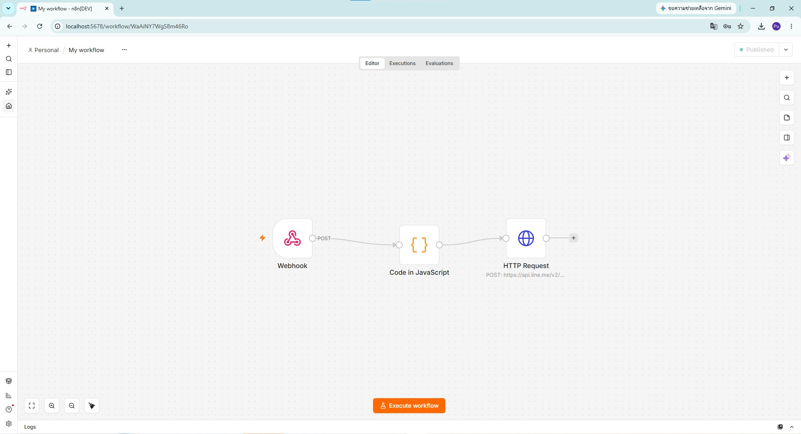
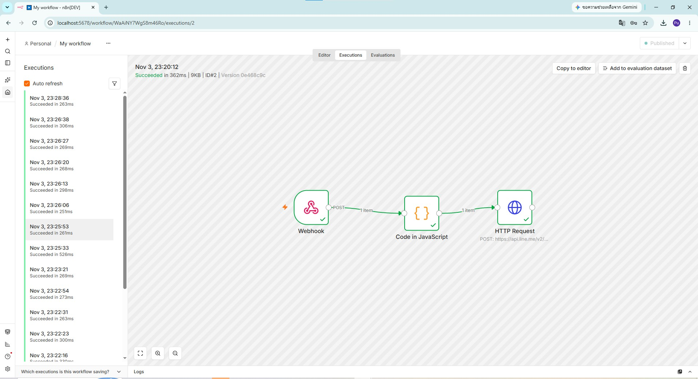
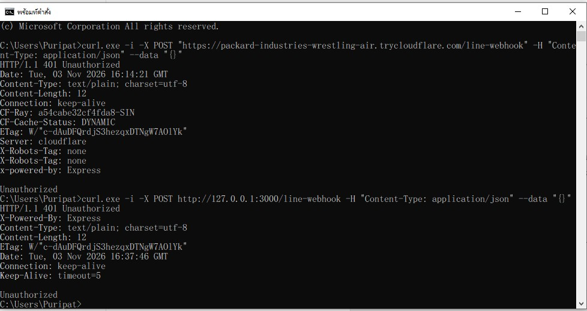
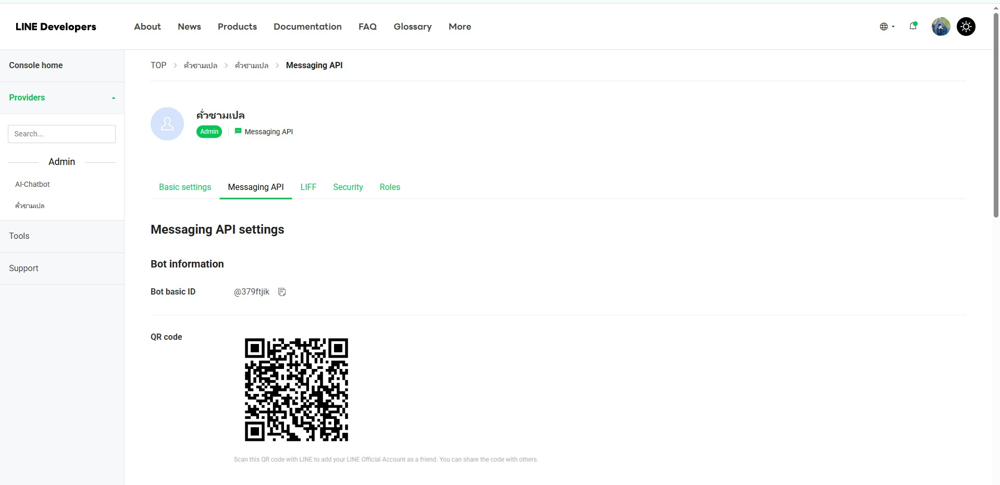
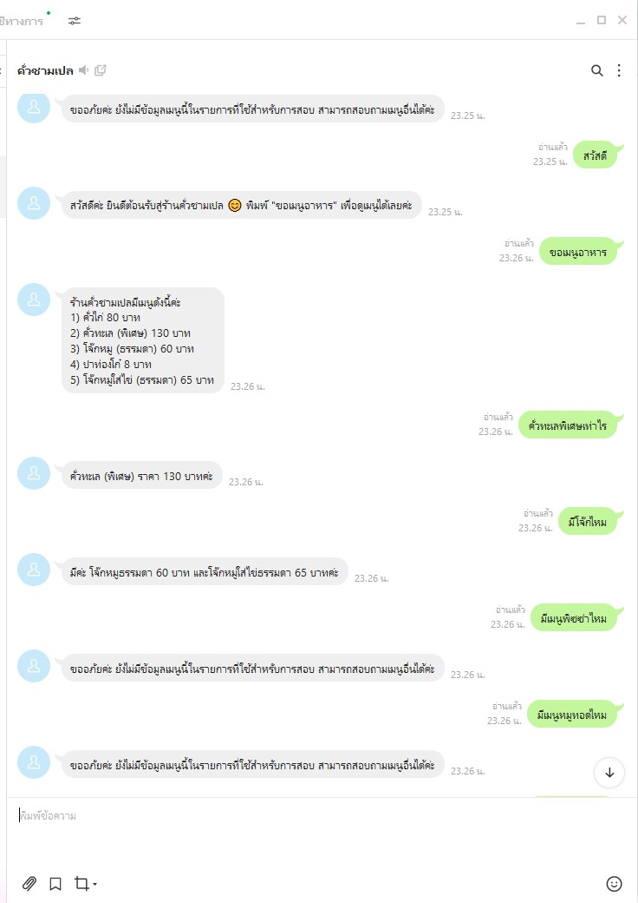

# LINE Chatbot ร้านคั่วชามเปล (Krua Cham Pay)

**รายวิชา:** CPE5013 Back-end Programming  
**หัวข้อ:** n8n Self-hosting + LINE Messaging API Webhook

## ข้อมูล LINE Bot

- **ชื่อบอต:** คั่วชามเปล
- **LINE Basic ID:** `@379ftjik`
- **รูปแบบการตอบคำถาม:** Rule-based ด้วย JavaScript
- **ระบบอัตโนมัติ:** n8n Self-hosting

## ภาพรวมโปรเจกต์

โปรเจกต์นี้พัฒนา LINE Chatbot สำหรับร้านอาหารคั่วชามเปล เพื่อให้ลูกค้าสามารถสอบถามรายการอาหาร ราคา และข้อมูลเมนูผ่าน LINE ได้โดยอัตโนมัติ

ระบบใช้ n8n แบบ Self-hosting ร่วมกับ Node.js, Express และ Cloudflare Tunnel เพื่อรับ Webhook ผ่าน HTTPS และส่งข้อความตอบกลับผ่าน LINE Messaging API

## System Architecture

```text
LINE User
    |
    v
LINE Messaging API
    |
    v
Cloudflare Tunnel (HTTPS)
    |
    v
Node.js + Express Gateway
    |
    | Verify x-line-signature
    v
n8n Self-hosting (Webhook)
    |
    v
Code in JavaScript (Rule-based)
    |
    v
HTTP Request
    |
    v
LINE Reply API
    |
    v
LINE User
```

## เทคโนโลยีที่ใช้

| เทคโนโลยี | หน้าที่ |
|---|---|
| n8n Self-hosting | จัดการ Workflow อัตโนมัติ |
| Node.js | รัน Webhook Gateway |
| Express.js | รับ HTTP Request |
| Cloudflare Tunnel | สร้าง HTTPS Endpoint |
| LINE Messaging API | รับและส่งข้อความ LINE |
| JavaScript | วิเคราะห์ข้อความด้วยเงื่อนไข Rule-based |
| HMAC-SHA256 | ตรวจสอบลายเซ็น LINE Webhook |

## เมนูและราคา

| เมนู | ราคา |
|---|---|
| คั่วไก่ | 80 บาท |
| คั่วทะเล (พิเศษ) | 130 บาท |
| โจ๊กหมู (ธรรมดา) | 60 บาท |
| ปาท่องโก๋ | 8 บาท |
| โจ๊กหมูใส่ไข่ (ธรรมดา) | 65 บาท |

## ความสามารถของ LINE Bot

1. ตอบข้อความทักทาย
2. แสดงรายการอาหารทั้งหมด
3. ตอบราคาอาหารเฉพาะเมนู
4. ตอบคำถามเกี่ยวกับโจ๊ก
5. แจ้งเมื่อไม่มีข้อมูลเมนูที่ถาม

## ความปลอดภัย

ระบบใช้ Express Gateway ตรวจสอบ `x-line-signature` จาก LINE Messaging API ด้วย HMAC-SHA256 และ Channel Secret ก่อนส่งข้อมูลไปยัง n8n

หากคำขอไม่มีลายเซ็นหรือลายเซ็นไม่ถูกต้อง ระบบจะตอบกลับ HTTP `401 Unauthorized`

Channel Secret และ Channel Access Token ถูกเก็บแยกจากไฟล์ที่เผยแพร่ใน Repository

## วิธีติดตั้งและใช้งาน

**ข้อกำหนดเบื้องต้น:** ต้องติดตั้ง Node.js, npm, n8n และ cloudflared รวมถึงมี LINE Messaging API Channel

1. ติดตั้ง Dependencies ด้วย `npm install`
2. สร้างไฟล์ `.env` และกำหนด `LINE_CHANNEL_SECRET` โดยใช้ค่าจริงจาก LINE Developers
3. เปิด n8n Self-hosting ด้วย `n8n start`
4. Import ไฟล์ `Krua_Cham_Pay_Workflow_Submission.json` เข้า n8n
5. ตั้งค่า Bearer Auth Credential ของ LINE ใหม่ใน HTTP Request Node
6. เปิดใช้งาน Workflow ด้วยการ Publish
7. เปิด Gateway ด้วย `node server.js`
8. เปิด Cloudflare Tunnel ด้วย `cloudflared tunnel --url http://127.0.0.1:3000`
9. นำ HTTPS URL ที่ได้รับมาต่อท้ายด้วย `/line-webhook` แล้วตั้งค่าเป็น Webhook URL ใน LINE Developers
10. เปิด Use webhook และทดสอบส่งข้อความจาก LINE

หมายเหตุ: Cloudflare Quick Tunnel เป็น URL ชั่วคราว เมื่อเริ่ม Tunnel ใหม่อาจจำเป็นต้องเปลี่ยน Webhook URL

## ผลการทดสอบ

| ข้อความที่ทดสอบ | ผลลัพธ์ |
|---|---|
| สวัสดี | ตอบข้อความต้อนรับ |
| ขอเมนูอาหาร | แสดงเมนูอาหาร 5 รายการ |
| คั่วทะเลพิเศษเท่าไร | ตอบราคา 130 บาท |
| มีโจ๊กไหม | ตอบราคาโจ๊ก 60 และ 65 บาท |
| มีเมนูพิซซ่าไหม | แจ้งว่าไม่มีข้อมูล |
| มีเมนูหมูทอดไหม | แจ้งว่าไม่มีข้อมูล |

## ภาพหลักฐาน

**1. n8n Workflow**



**2. ผลการทำงานของ Workflow**



**3. การทดสอบ LINE Signature**



**4. QR Code ของ LINE Bot**



**5. การทดสอบสนทนากับ LINE Bot**



## ไฟล์สำคัญ

- `Krua_Cham_Pay_Workflow_Submission.json` — n8n Workflow
- `server.js` — LINE Webhook Gateway
- `package.json` — Node.js Dependencies
- `รูปหลักฐาน/` — ภาพประกอบการทดสอบ

## หมายเหตุ

Repository นี้จัดทำเพื่อใช้ประกอบการประ
